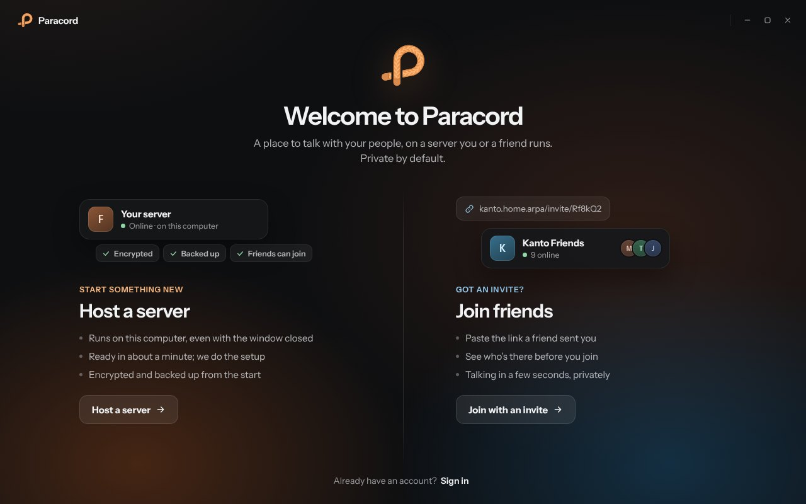
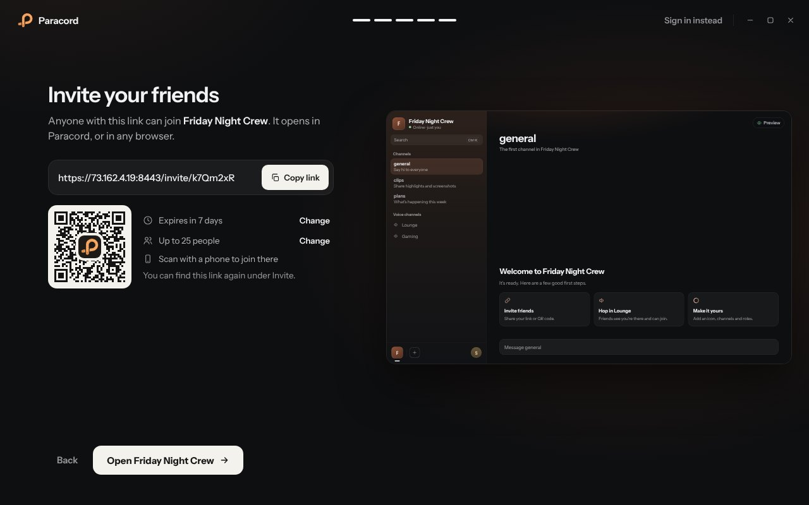
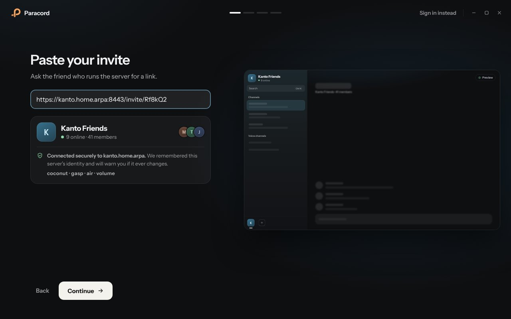
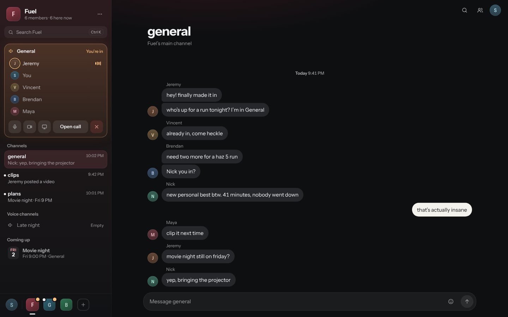
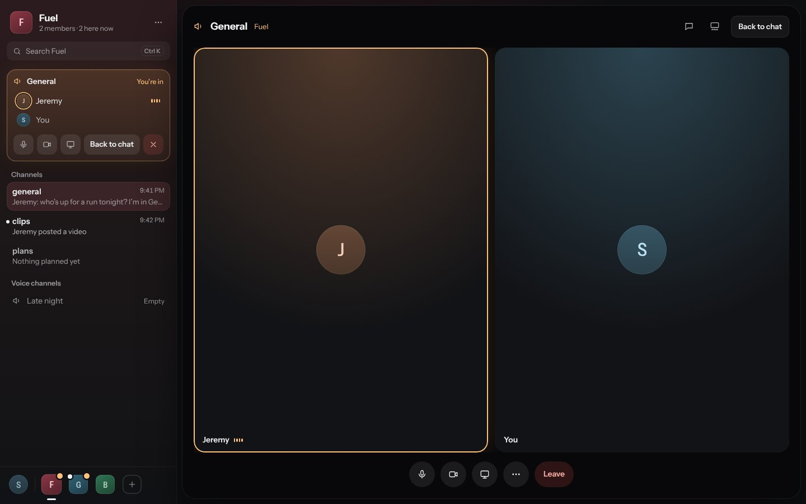
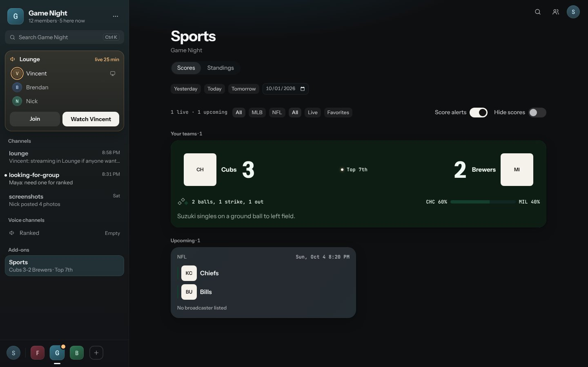
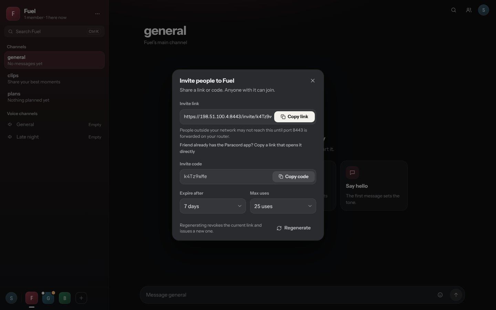
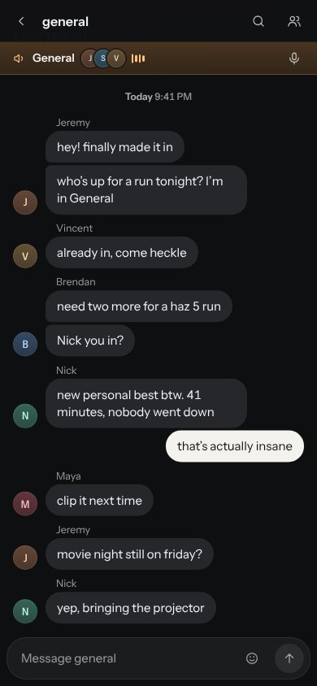
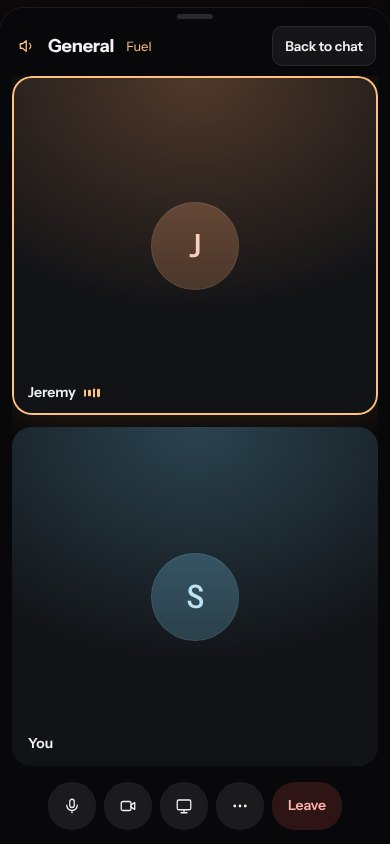

<p align="center">
  
</p>

<p align="center">
  Text, voice and video chat for your friends or a small community, on a server you or a friend runs.
</p>

<p align="center">
  <a href="../../releases/latest"></a>
  
  <a href="LICENSE"></a>
</p>

<p align="center">
  <a href="../../releases/latest">Download</a> ·
  <a href="#getting-started">Getting started</a> ·
  <a href="#a-look-around">A look around</a> ·
  <a href="#privacy-and-security">Privacy and security</a> ·
  <a href="#whats-in-it">What's in it</a> ·
  <a href="#running-a-server-without-the-app">Without the app</a> ·
  <a href="#development">Development</a>
</p>

<p align="center">
  Current release: <strong>v4.0.1</strong> · <a href="RELEASE_NOTES.md">what changed</a>
</p>

---



Paracord works about how you'd expect from Discord: servers, text and voice channels,
direct messages, screen sharing, roles and moderation. The difference is that there's no
company in the middle. One person in your group runs the server, usually from the
Paracord app on their own computer, and everyone else joins with a link.

Open the app and it asks one question: are you **hosting** a server or **joining** one?

- **Host** and the app sets up a server on your computer in about a minute. It runs in the
  background, encrypts what it stores, backs itself up every day, asks your router to let
  your friends in, and hands you an invite link.
- **Join** and you paste the link a friend sent you. You see the server and who's in it
  before you make an account, and you're talking a few seconds later.

You make one password. Private messages, voice and video are encrypted end to end, and
the server never learns the key that locks them.

It's a young project, and it suits a group where somebody doesn't mind their computer
staying on while friends are around. [Good to know](#good-to-know) lists what doesn't
work yet.

## Getting started

Get the app for your computer from [Releases](../../releases/latest):

| | File |
|---|---|
| Windows | `Paracord-Setup-<version>.exe` |
| macOS | `Paracord_<version>_aarch64.dmg` (Apple Silicon) or `Paracord_<version>_x64.dmg` (Intel) |
| Linux | `Paracord_<version>_amd64.deb`, `Paracord-<version>-1.x86_64.rpm` or `Paracord_<version>_amd64.AppImage` |

The app updates itself when a new release comes out.

### Hosting a server

Choose **Host a server**, name it, pick a color, and make your account. The app does the
rest while you watch:


Then it shows your recovery phrase, 24 words that get your account back if you forget
your password or lose the computer. Write them down somewhere safe. Nobody, including
you as the server's owner, can reset them for you.

The last screen is your invite link, with a QR code for phones:



The server keeps running when you close the app, and starts again when you sign in to
your computer. Settings › This computer shows that it's running, whether friends can
reach it, its backups, and buttons to stop it, update it or remove it.

**Friends outside your home.** An invite link always uses your public internet address.
Paracord asks your router to forward its port (UPnP, NAT-PMP or PCP), and most routers
agree. If yours doesn't answer or says no, the invite says so, and Paracord shows the exact
steps for your router: forward port `8443`, TCP and UDP, to this computer. [Friends outside
your network](docs/port-forwarding.md) walks through it, including what to do when your
internet provider shares one public address among several customers.

### Joining a server

Choose **Join friends** and paste the invite link. Paracord shows the server before you
commit, along with four words that identify it. If the server's identity ever changes,
the app stops and asks you instead of quietly connecting somewhere else.



A `paracord://` invite opens straight in the app. No app? An invite link also works in any
browser, which shows the same server and a way to make an account.

### Already have an account?

**Sign in** on the welcome screen with your server's address or any invite to it, then your
username and password. Your encryption keys come back from an encrypted backup on your
server, which only your password unlocks.

## A look around

Every picture here is the real app, filled in with sample people.



Who's in a voice channel, and what they're doing, sits at the top of the server's sidebar.
Join with one click, or watch somebody's stream without joining the call.

| | |
| :--- | :--- |
|  |  |
| Calls with video and screen sharing. Streams can go full screen, edge to edge. | Follow a game together: live scores, standings and play-by-play. |



Invite links say plainly who they'll work for.

It works on phones too, in the browser:

<p align="center">
   
</p>

## Privacy and security

These are on from the start. There's nothing to turn on.

- **One password, two keys.** Your device turns your password into one key that signs you
  in and another that locks your messages. The server only ever sees the first.
- **Private messages, voice and video are end-to-end encrypted.** That includes one-to-one
  and group conversations and their attachments. Group keys change when somebody joins or
  leaves, and every message is signed, so nobody can post as somebody else.
  [How encryption works](docs/encryption.md).
- **What the server stores is encrypted on its disk.** The key lives in your computer's
  keychain, and your recovery phrase can unlock a copy of it if that computer is lost.
- **Daily backups,** kept on the host computer for 14 days. A new computer can restore one
  with the recovery phrase.
- **New servers are invite-only.** Nobody can make an account without a link.
- **Link previews and activity sharing** have their own switches in Settings › Privacy.

Messages in a server's channels are a different matter: they are **not** end-to-end
encrypted. The person running the server can read them. Running your own server decides
where your conversations live, which is a smaller promise than end-to-end encryption.
[Known limitations](docs/known-limitations.md) sets out what the server can and can't see.

## What's in it

**Talking.** Text channels, announcement channels, forums and threads. Replies, mentions,
reactions with who reacted, pins, saved messages and reminders. Forward a message with a
note. Markdown, code blocks, attachments, image previews and link embeds. Polls, scheduled
messages, slash commands, GIFs, stickers and custom emoji. Search a whole server with
filters, an inbox, unread counts and per-channel notifications.

**Voice, video and screen sharing.** Voice channels, video, screen sharing with system audio,
and full-screen streams, over Paracord's own QUIC transport, so there's no third-party media
service to sign up for. Opus audio with noise suppression, VP9 video, and media the server
relays without being able to read it.

**Together in a call.** Watch or listen together from a YouTube link, a video link or a file
posted in the server, with a shared queue. A soundboard of the server's own sounds.

**Running a community.** Roles and fine-grained permissions. Invites, onboarding and welcome
screens. Bans, reports, moderation templates and audit logs. Automatic moderation for
keywords, links, mention floods and spam ([AutoMod](docs/automod.md)). Events with RSVP.

**Add-ons.** Turn on extras for a server in its settings:

- **Feeds** bring new posts from blogs, YouTube channels, GitHub releases, Twitch and a
  Jellyfin library into a channel.
- **Game servers** show whether your Minecraft or Steam servers are up and who's playing.
- **Daily word**, a five-letter puzzle with the same word for everyone each day.
- **Sports**, with live scores, standings and score updates posted in a channel. The server
  fetches scores, so members' devices never contact the score provider. See
  [Sports](docs/sports.md).

**Several servers, bots and more.** One app connects to as many Paracord servers as you
like. Bot applications with slash commands, webhooks, and a
[bot SDK](packages/paracord-bot-sdk). Servers can link to each other with signed requests,
which is off by default; read [Federation Protocol](docs/federation-protocol.md) first.

## Good to know

What's most likely to come up. The full list is in
[known limitations](docs/known-limitations.md) and the [release notes](RELEASE_NOTES.md).

- **The host computer needs to be on** for people to talk. The server starts when you sign
  in to that computer, not before.
- **Your router may need one change.** If it doesn't do automatic port forwarding, forward
  port `8443`, TCP and UDP, by hand. UDP is the half people forget, and calls stay silent
  without it.
- **Paracord looks up your public address** when your router won't say what it is. The
  server sends one small request to a public STUN server (Cloudflare's, then Google's), at
  most every 30 minutes. That server sees your network's public address and nothing else.
  `external_address_stun_servers = []` in the server's settings file turns it off, but then
  there's no invite link until your router names the address.
- **3.x apps need to update.** A 4.0 server asks older apps to update before they make an
  account. Accounts made before 4.0 keep working, and the app offers to move them to one
  password.
- **Joining a call from a browser** needs a Chromium-based browser such as Chrome or Edge.
  The desktop app works everywhere.
- **macOS builds** may be unsigned, in which case the first launch needs right-click › Open.
  System audio isn't captured in a screen share from a Mac.
- **Linux screen sharing** goes through your desktop's PipeWire and portal setup, so try it
  before you need it.

## Running a server without the app

For a machine that's always on, such as a home server or a VPS, install the server on its
own. It's the same server the app runs, with the same encryption and backups.

**Linux or macOS:**

```bash
curl -fsSL https://raw.githubusercontent.com/Scdouglas1999/Paracord/main/scripts/install.sh | sh
```

**Windows** (PowerShell; it asks for administrator permission itself):

```powershell
irm https://raw.githubusercontent.com/Scdouglas1999/Paracord/main/scripts/install.ps1 | iex
```

The installer sets the server to start by itself, asks your router to let friends in, and
opens a one-time link in your browser where you make the owner's account and name the
server. Running it again later updates Paracord and keeps your data.
[Getting Started](docs/getting-started.md) covers what it does on each system, offline
installs, and checking downloads against `SHA256SUMS.txt`.

**Docker Compose:**

```bash
curl -fsSL -o docker-compose.yml https://raw.githubusercontent.com/Scdouglas1999/Paracord/main/docker-compose.yml
PARACORD_PULL_POLICY=missing docker compose up -d
```

This one expects a reverse proxy in front for HTTPS; [Docker Setup](docs/docker-setup.md)
has an example.

### Ports, data and certificates

| | Default | Other option |
|---|---|---|
| TCP `8443` | the web app, the API and the live connection | |
| UDP `8443` | voice, video and screen sharing | |
| Database | SQLite, encrypted on disk | PostgreSQL |
| Uploads | the local disk | S3-compatible storage |
| HTTPS | a certificate the server makes itself, remembered by the app | a domain name with automatic certificates, or a reverse proxy |

A server with its own certificate shows browsers a one-time warning; the app checks the
server's identity itself and never shows one. A domain name with automatic certificates
takes about fifteen minutes ([Deployment](docs/deployment.md)). For sustained use by a large
group, `migrate-to-postgres` moves a SQLite database to PostgreSQL.

## Architecture

The server is a Rust workspace: axum on Tokio, SQLx over SQLite (SQLCipher) or PostgreSQL,
a REST API and a realtime gateway. The client is React 19, TypeScript, Tailwind CSS v4 and
Zustand in a Tauri v2 shell. The desktop app carries the server binary with it, so
"Host a server" runs the same server as a standalone install.

```text
crates/
├── paracord-server       # the server: paracord-server, and paracord-host as the app runs it
├── paracord-hostctl      # runs that server as a service for your account
├── paracord-api          # HTTP API
├── paracord-ws           # realtime gateway
├── paracord-core         # permissions, services, reachability, event bus
├── paracord-db           # SQLite and PostgreSQL persistence
├── paracord-models       # shared types and permission flags
├── paracord-contracts    # API types shared with the client
├── paracord-transport    # QUIC and WebTransport
├── paracord-relay        # encrypted media routing
├── paracord-codec        # Opus, RNNoise and VP9
├── paracord-media        # file storage
├── paracord-util         # IDs, validation, encryption at rest
└── paracord-federation   # signed server-to-server protocol

client/                   # React app and Tauri desktop shell
packages/paracord-bot-sdk # bot SDK
```

## Development

You need [Rust 1.88 or newer](https://rustup.rs/), [Node 22 or newer](https://nodejs.org/),
libvpx for VP9 video, and Tauri's platform dependencies for the desktop app. `CLAUDE.md` has
the per-platform notes.

Run the client against a local server:

```bash
# terminal 1
cd client && npm install && npm run dev

# terminal 2
cargo run --bin paracord-server --no-default-features
```

Check and test:

```bash
cd client && npm run host:stage -- --placeholder && cd ..   # once, see below
cargo fmt --all -- --check
cargo clippy --workspace -- -D warnings
cargo test --workspace

cd client
npm test              # typecheck plus unit tests
npm run test:e2e      # Playwright
```

Build the server, then the desktop app:

```bash
cd client && npm install && npm run build && cd ..
cargo build --release --bin paracord-server

cd client && npm run host:stage -- --release && npx tauri build
```

The desktop crate is part of the Cargo workspace and bundles the server it runs for
"Host a server", so every `--workspace` command needs that file staged first.
`--placeholder` stages a stand-in for checks and tests; a release build refuses it.

Don't turn off the `vpx` feature to get past a build error. The build succeeds, and video
and screen sharing then fail at runtime. Fix the libvpx setup instead.

## Documentation

| Guide | Covers |
|---|---|
| [Getting Started](docs/getting-started.md) | hosting from the app, the installers, the first run |
| [Friends outside your network](docs/port-forwarding.md) | the router side, and how to check it worked |
| [How encryption works](docs/encryption.md) | what's encrypted end to end, what the server sees, stored data |
| [Backup Recovery](docs/backup-recovery.md) | restoring a server from a backup |
| [Deployment](docs/deployment.md) | a domain name, a reverse proxy, PostgreSQL |
| [Docker Setup](docs/docker-setup.md) | compose services, volumes, reverse proxy |
| [Known Limitations](docs/known-limitations.md) | what does and doesn't work |
| [AutoMod](docs/automod.md) | rules, triggers and actions |
| [Sports](docs/sports.md) | scores and standings for a server |
| [Bot Development](docs/bot-development.md) | bots, commands, interactions, webhooks |
| [Federation Protocol](docs/federation-protocol.md) | signed requests between servers |
| [Security policy](SECURITY.md) | reporting a vulnerability privately |
| [Release Notes](RELEASE_NOTES.md) | what changed in each release |

## License and contributing

Paracord is source-available rather than open source, under the [Paracord Source-Available
License](LICENSE). You can run it for anything, including a business. You can read the
source, modify it for your own machines, and pass the official releases around unchanged.
Publishing a modified version, or a fork for other people to use, needs written permission
from the author.

Issues and pull requests are welcome. For a bug, say what you did and what happened. If it
involves voice, screen sharing or encryption, include your platform and whether you were in
the browser or the app.

Found a security problem? Please don't open an issue for it. Report it privately as
[SECURITY.md](SECURITY.md) describes.
